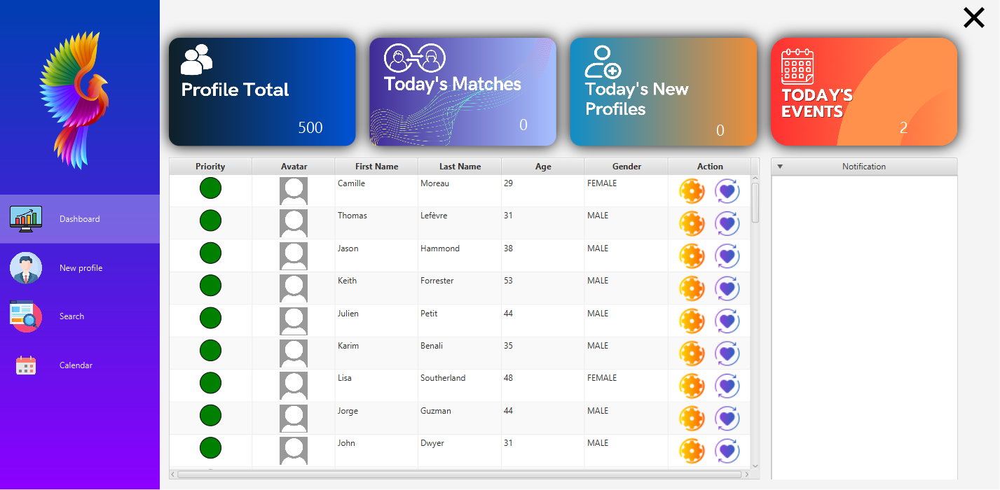
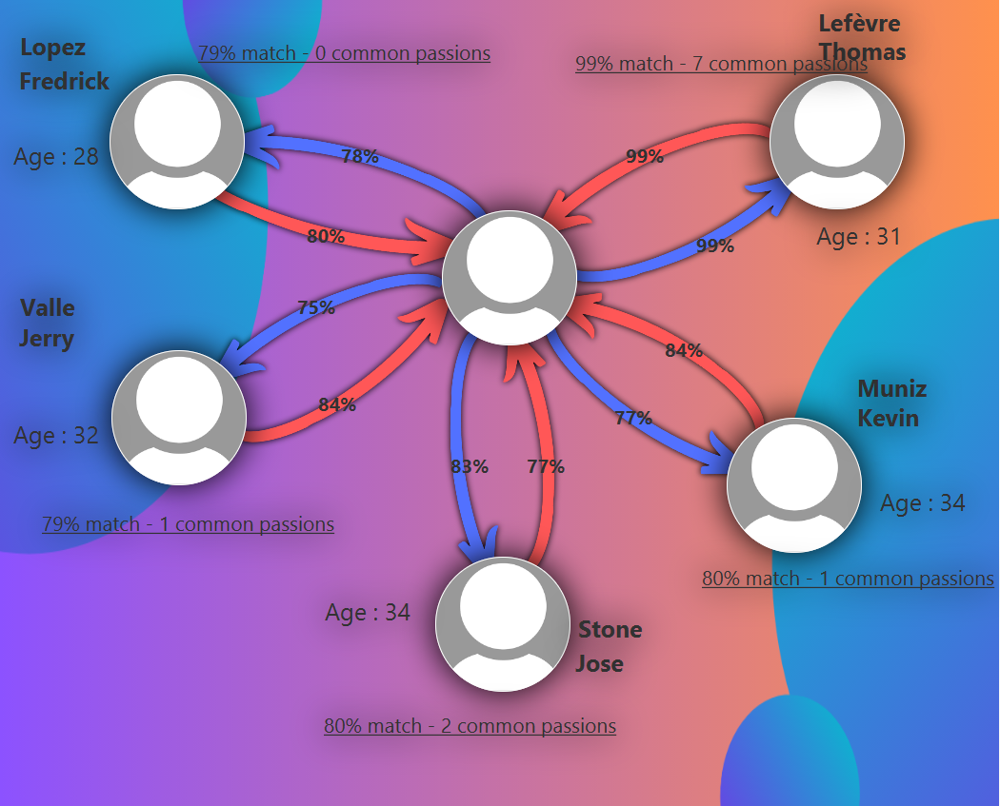
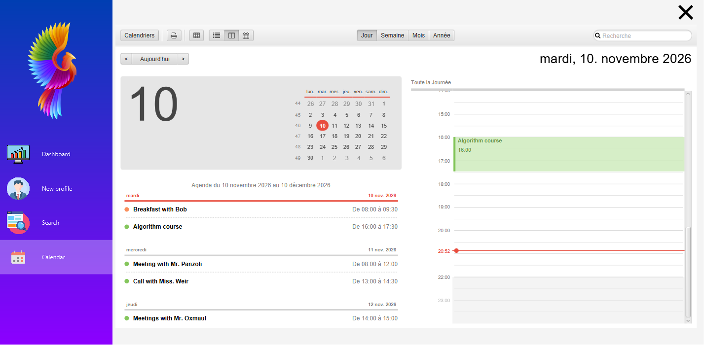

<p align="center">
  
</p>
<h1 align="center"> JavaGOAT - Matrimonial Agency </h1>
<h3 align="center"> Second Year Java Project - Data Structures & Algorithms </h3>
<h5 align="center"> University project (2023), revived in 2026: fixed build, new matching algorithm, saved calendar </h5>

<div align="center">
  
  
  
  
</div>

<p align="center">
    
</p>

<!-- TABLE OF CONTENTS -->
<h2 id="table-of-contents"> :book: Table of Contents </h2>

<details open="open">
  <summary>Table of Contents</summary>
  <ol>
    <li><a href="#about-the-project"> ➤ About The Project</a></li>
    <li><a href="#features"> ➤ Features</a></li>
    <li><a href="#getting-started"> ➤ Getting Started</a></li>
    <li><a href="#quick-tour"> ➤ Quick Tour</a></li>
    <li><a href="#matching"> ➤ How the Matching Works</a></li>
    <li><a href="#data"> ➤ Data</a></li>
    <li><a href="#tests"> ➤ Tests</a></li>
    <li><a href="#structure"> ➤ Project Structure</a></li>
    <li><a href="#revival"> ➤ 2026 Revival</a></li>
    <li><a href="#limitations"> ➤ Known Limitations</a></li>
    <li><a href="#credits"> ➤ Credits</a></li>
  </ol>
</details>


<!-- ABOUT THE PROJECT -->
<h2 id="about-the-project"> :pencil: About The Project</h2>

<p align="justify">
JavaGOAT is a desktop application for a <strong>matrimonial agency</strong>: the agency registers people with their
profile and what they are looking for, and the application suggests the most compatible partners, keeps the history
of the matches and the opinion of each person, and organises the agency's agenda.
</p>

<p align="justify">
The main goal was to put into practice our knowledge of <strong>data structures and algorithms</strong>, inside a
simple and guided application. The project was revived in 2026: it builds again with one command, the bugs found
during an audit are fixed and covered by tests, the matching algorithm and the dataset were rewritten, and the
calendar and statistics are now saved.
</p>


<!-- FEATURES -->
<h2 id="features"> :star2: Features</h2>

- 📊 **Dashboard**: total profiles, today's matches, today's new profiles and today's events, computed from the saved
  data. The profiles waiting the longest for a match come first (🟢 more than 2 weeks, 🟠 1–2 weeks, 🔴 less than a week).
- 👤 **Profile creation & edition**: identity, physical attributes, lifestyle, passions, picture, and **preferences**
  (accepted values + importance for each criterion). Status dots show which part of the form is complete.
- 🔎 **Search** with first name / last name auto-completion.
- 💘 **Matching page**: the 5 most compatible people not matched yet, with the satisfaction in both directions.
- 🗂️ **Match history & feedback**: each person can give a positive or negative opinion about a past match.
- 📅 **Calendar** (day / week / month / year views, recurring events), saved between sessions.
- 💾 **Readable JSON storage**, validated at start-up with clear error messages; atomic saves.


<!-- GETTING STARTED -->
<h2 id="getting-started"> 🚀 Getting Started</h2>

<table>
  <tr>
    <th>Requirement</th>
    <th>Version</th>
  </tr>
  <tr>
    <td>JDK</td>
    <td>19 or newer (tested with OpenJDK 20 on Windows 11)</td>
  </tr>
  <tr>
    <td>Maven</td>
    <td>Nothing to install: the Maven Wrapper (<code>mvnw</code>) downloads Maven 3.9.9</td>
  </tr>
  <tr>
    <td>Internet</td>
    <td>For the first build only (Maven, JavaFX and the libraries are downloaded)</td>
  </tr>
</table>

> [!IMPORTANT]
> `JAVA_HOME` must point to the JDK, and every command must be run **from the project root** (the data files are
> read relative to it). With an older JDK the build stops with "JavaGOAT needs JDK 19 or newer".

<details open>
<summary><b>Windows (PowerShell)</b></summary>

```powershell
git clone https://github.com/SteelPotathor/JavaGOAT.git
cd JavaGOAT
$env:JAVA_HOME = "C:\path\to\jdk-20"   # e.g. "$HOME\.jdks\openjdk-20" for a JDK downloaded by IntelliJ
.\mvnw.cmd clean javafx:run            # build and start the application
```
</details>

<details>
<summary><b>Linux / macOS / Git Bash</b></summary>

```bash
git clone https://github.com/SteelPotathor/JavaGOAT.git
cd JavaGOAT
export JAVA_HOME=/path/to/jdk-20
./mvnw clean javafx:run
```
</details>

<details>
<summary><b>IntelliJ IDEA</b></summary>

Open the folder as a Maven project, select a JDK ≥ 19, then run the Maven goal `javafx:run`.
To run `ApplicationStart` directly instead, add the VM option
`--add-exports=javafx.base/com.sun.javafx.event=org.controlsfx.controls` (needed by the search auto-completion)
and keep the project root as working directory.
</details>

> [!TIP]
> The data are saved when you quit with the ✖ button or the window close button.


<!-- QUICK TOUR -->
<h2 id="quick-tour"> :question: Quick Tour</h2>

The shipped data contains 12 hand-written **showcase profiles** designed to demonstrate the algorithm:

<ol>
  <li><b>Search</b> page → click the 💜 button of <b>Camille Moreau</b> (first row).</li>
  <li><b>Thomas</b> comes first with 99 %: both fit each other's preferences and share 7 passions.</li>
  <li><b>Hugo</b> (daily smoker) and <b>Julien</b> (44) never appear: Camille marked "non-smoker" and "27–35 years old"
      as <i>Required</i>.</li>
  <li>Click a suggestion to make the match: it disappears from the suggestions and the dashboard counts it.</li>
  <li><b>Calendar</b> page: create or move an event, quit, restart: it is still there.</li>
</ol>

Every showcase profile has a `note` explaining what it shows (asymmetric interest, same-sex search, bisexual
profile, common passions, already matched couple…) in [`data/showcase-profiles.json`](data/showcase-profiles.json).

<table>
  <tr>
    <td></td>
    <td></td>
  </tr>
</table>


<!-- MATCHING -->
<h2 id="matching"> ⚙️ How the Matching Works</h2>

For every criterion, each person states the **accepted values** and an **importance**:

| Importance | Effect |
| :--- | :--- |
| *Indifferent* | The criterion is ignored |
| *Nice to have* | Counts with its normal weight |
| *Important* | Counts three times more |
| *Required* | Eliminatory: a candidate who does not fully satisfy it is never suggested |

The criteria are the age, size and IQ ranges, smoker, alcohol, sport, diet, religion, body build, hair (colour,
type, length) and ethnicity. The sexes looked for are always eliminatory.

1. **Satisfaction of A with B** (between 0 and 1): weighted average of the criteria of A. Outside a range the
   satisfaction decreases progressively (e.g. over 5 years for the age), and a neighbouring value counts partly
   ("occasionally" when "never" was asked). Common passions are added (`common / √(countA × countB)`).
2. **Compatibility** = `100 × √(satisfaction(A→B) × satisfaction(B→A))`: a geometric mean, so a suggestion must suit
   **both** people. On the matching page, the blue arrow is how well the candidate fits the selected person, the red
   arrow the other way round.
3. The 5 best candidates not matched yet are shown, computed on demand (all 500 rankings take about 0.3 s).

All weights and tolerances are documented in
[`matching.properties`](src/main/resources/com/example/javagoat/Model/matching/matching.properties) and can be
overridden without recompiling by creating `data/matching.properties` with only the keys to change:

```properties
# common passions count more
weight.passions=8
```

An unknown key or an invalid value stops the application with a message naming the key.


<!-- DATA -->
<h2 id="data"> 💾 Data</h2>

| File | Role |
| :--- | :--- |
| `data/seed/profiles.json` | Shipped agency: 12 showcase profiles + 488 generated profiles |
| `data/seed/calendar.json` | Shipped calendar: demo events, one recurring every Monday |
| `data/profiles.json`, `data/calendar.json` | Working files (not versioned), created from the seed and written on exit |
| `data/showcase-profiles.json` | The hand-written showcase profiles |

To start again from the shipped data, close the application and delete `data/profiles.json` and/or
`data/calendar.json`. Another data directory can be used with `-Djavagoat.dataDir=<directory>`.

The 488 other profiles come from a **reproducible generator** (realistic distributions, preferences consistent with
the person, shared interests, past matches with votes):

```powershell
.\mvnw.cmd compile exec:java                                                  # rewrites data/seed/profiles.json
.\mvnw.cmd compile exec:java "-Dexec.args=--count=300 --seed=7 --reference-date=2026-11-10"
```

The JSON formats (every field and accepted value) are described in [data/README.md](data/README.md).


<!-- TESTS -->
<h2 id="tests"> 🧪 Tests</h2>

```powershell
.\mvnw.cmd test
```

The JUnit 5 tests cover the matching algorithm and the showcase scenarios, the settings validation, the JSON
storage (round trip, error reports), the calendar, the dashboard statistics, the dataset generator, the form
validation and the regressions fixed during the revival. They never touch your working data.


<!-- STRUCTURE -->
<h2 id="structure"> 🏗️ Project Structure</h2>

```
JavaGOAT
├── data/                         profiles, calendar and settings (see data/README.md)
├── src/main/java/com/example/javagoat
│   ├── *_Controller.java         one JavaFX controller per page
│   ├── PreferencesForm.java      preference panels shared by the creation and edition pages
│   └── Model/
│       ├── matching/             Matcher, criteria, importance, MatchingSettings
│       ├── storage/              JSON reading/writing with validation (Gson)
│       ├── dataset/              DatasetGenerator
│       └── ...                   Profile, ModelMatch, ModelCalendar, history...
├── src/main/resources/...        FXML pages, CSS, images, default matching.properties
└── src/test/java/...             JUnit 5 tests
```

Main libraries: [JavaFX](https://openjfx.io/), [ControlsFX](https://controlsfx.github.io/),
[CalendarFX](https://github.com/dlsc-software-consulting-gmbh/CalendarFX), [AnimateFX](https://github.com/Typhon0/AnimateFX),
[Gson](https://github.com/google/gson).


<!-- REVIVAL -->
<h2 id="revival"> 🛠️ 2026 Revival</h2>

<details>
<summary>What changed compared to the 2023 version</summary>

- **Build**: AnimateFX dependency fixed, stable JavaFX 19.0.2.1 instead of an early-access build, Maven Wrapper,
  JDK version check.
- **Bugs**: crash when creating a profile with some passions, data lost when closing the window, wrong suggestions,
  duplicated profiles, wrong ids after a deletion, status dots turning green too early…
- **Matching**: vector distance replaced by preferences with ranges and importance, mutual compatibility,
  settings file.
- **Data**: binary Java serialization replaced by validated JSON; new realistic dataset and showcase profiles.
- **Calendar & dashboard**: events saved, statistics computed from the saved data.
- **Tests**: from none to a JUnit 5 suite.
</details>


<!-- LIMITATIONS -->
<h2 id="limitations"> :warning: Known Limitations</h2>

- The data are saved when the application is closed: a crash loses the changes of the session.
- The dashboard notifications are kept for the current session only.
- "Today's new profiles" counts the profiles created in the application (the shipped ones have no creation date).
- The calendar has two calendars (*Work* and *Personal*); adding other calendars is disabled.


<!-- CREDITS -->
<h2 id="credits"> :scroll: Credits</h2>

*   **<a href="https://github.com/L0rest">L0rest</a>**
*   **<a href="https://github.com/OG-Mihawk">OG-Mihawk</a>**, for the amazing UI
*   **<a href="https://github.com/SteelPotathor">SteelPotathor</a>**

Thanks to Mr. Panzoli (PhD) for guiding us through this project.

[](https://github.com/SteelPotathor)
